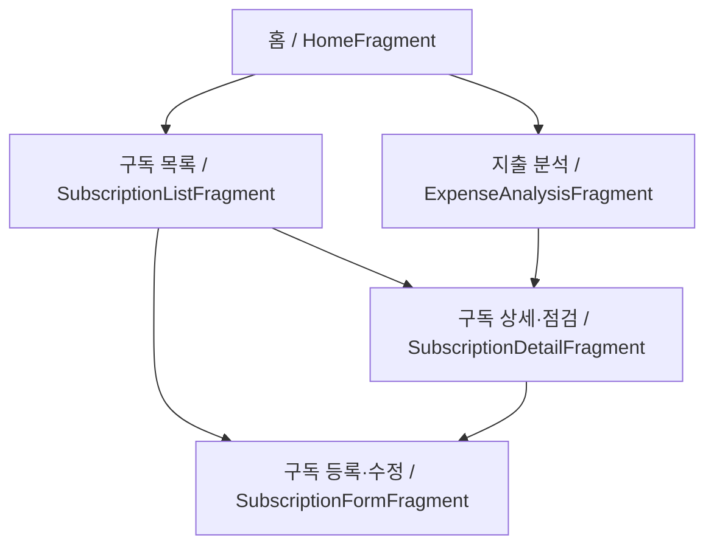

# 화면 및 데이터 설계

## 화면 이동

하단 메뉴로 홈, 구독 목록, 지출 분석 간 이동합니다. 홈의 구독 점검 버튼은 구독 목록으로 이동합니다.

## 입력 및 표시

- 등록·수정: 서비스명·결제 금액 EditText, 카테고리 Spinner, 월간·연간 결제 주기 선택, DatePicker, 무료 체험 CheckBox 및 종료일 입력, 저장 버튼
- 목록: 서비스명, 결제 금액, 결제 주기, 다음 결제일, 구독 상태를 RecyclerView에 표시
- 상세·점검: 최근 30일 이용 빈도 RadioGroup, 점검 저장, 점검 권장 메시지, 수정 및 해지 처리
- 분석: 월평균·연간 환산 구독료, 카테고리별 금액과 비율, 점검 대상 목록, 예상 절약액

## Room 데이터베이스

데이터베이스 이름: `suboff_database`

### Subscription

| 컬럼 | SQLite 타입 | 제약 | 설명 |
| --- | --- | --- | --- |
| id | INTEGER | PK, 자동 증가 | 구독 고유번호 |
| name | TEXT | NOT NULL | 서비스명 |
| category | TEXT | NOT NULL | 카테고리 |
| price | INTEGER | NOT NULL | 결제 금액 |
| billingCycle | TEXT | NOT NULL | 결제 주기 (예: MONTHLY) |
| billingDate | TEXT | NOT NULL | 결제 기준일 |
| isFreeTrial | INTEGER | NOT NULL | 무료 체험 여부 |
| trialEndDate | TEXT | NULL 허용 | 무료 체험 종료일 |
| status | TEXT | NOT NULL | 구독 상태 (예: ACTIVE) |
| canceledAt | TEXT | NULL 허용 | 해지 처리 날짜 |

### UsageReview

| 컬럼 | SQLite 타입 | 제약 | 설명 |
| --- | --- | --- | --- |
| id | INTEGER | PK, 자동 증가 | 점검 기록 고유번호 |
| subscriptionId | INTEGER | FK, NOT NULL | Subscription.id 참조 |
| usageFrequency | TEXT | NOT NULL | 최근 30일 이용 빈도 (예: RARELY) |
| reviewDate | TEXT | NOT NULL | 점검 날짜 |

하나의 구독에 여러 이용 점검 기록이 연결됩니다. 날짜 예시는 `2026-10-26` 형식입니다.

## 데이터 처리

- 등록: 사용자 입력 → Repository → SubscriptionDao → Room DB
- 목록: Room DB → SubscriptionDao → Repository → RecyclerView
- 수정·해지 상태 변경: 수정 정보 → SubscriptionDao → Room DB
- 이용 점검: 이용 빈도와 날짜 → UsageReviewDao → Room DB
- 지출 분석: 활성 구독 및 최신 점검 결과 조회 → 금액 계산 → 화면 표시

## 구현 시 확정할 세부 정책

기획서에서 다음 세부 규칙은 확정하지 않았으므로 구현 전에 결정합니다.

- 이용 빈도 전체 선택 항목과 점검 대상 판정 기준
- 무료 체험 종료 임박 기준 일수
- 월말·윤년·기준일 당일의 다음 결제일 계산 규칙
- 연간 요금의 월평균 환산 및 소수 금액 반올림 규칙
- 무료 체험 및 해지 구독의 지출 집계 처리
- 외래키 삭제 정책과 최신 점검 기록의 동률 처리

푸시 알림, 금융기관 연동, 실제 서비스 자동 해지는 현재 기획의 구현 범위로 명시되어 있지 않습니다.
